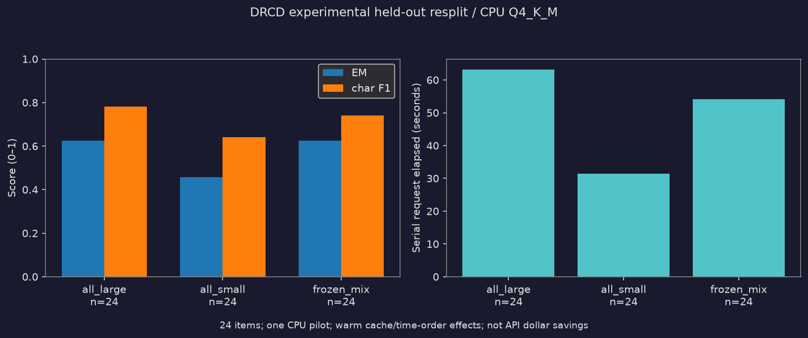

# LLM cost frontier：成本快照核對與 DRCD CPU 小試驗

> 舊算術核對的程式、輸入、結果與 CLI 行為均保留。新增的真實模型實驗以 [drcd_cpu.ipynb](drcd_cpu.ipynb) 為主要入口；**預設 replay，不下載、不啟動 server、不重新生成**。Notebook 的資料下載、抽樣、HTTP 推論、評分、凍結選擇、實際派工及圖表均為原生 cells，不是外部 Python main 的包裝。

## DRCD：重播 / 新跑

Python 3.13 已實跑；套件由本目錄 `uv.lock` 固定，不使用父 repo 環境：

```bash
cd /home/wens/projects/deep-dive-code/llm-cost-frontier
uv sync --frozen --extra drcd --python 3.13
uv run --frozen --extra drcd python -m unittest discover -s tests -v
# 離線重播保存結果、重新評分並重畫圖；輸出另存，不覆寫 fresh 證據
uv run --frozen --extra drcd python run_drcd_notebook.py replay
```

若已有鎖定環境，replay 不需網路；首次 `uv sync` 仍需下載依賴。不要把依賴安裝也稱作離線。互動式 Notebook 可直接 run-all；只有 `DRCD_MODE=fresh` 才做新實驗。新跑前**自行備份並移走** `results/drcd-cpu/`，現有 raw JSONL 存在時程式會拒絕混寫。

```bash
# 注意：會下載公開權重 / 固定 parquet / CPU binary，並消耗本機 CPU 時間
uv run --frozen --extra drcd python run_drcd_notebook.py fresh
```

`run_drcd_notebook.py` 僅是 kernel/產物基礎設施：IPC transport、非阻塞 AsyncKernelClient、指定本專案 Python、finally 關閉 channels/kernel，replay 額外阻擋 HTTP；核心實驗仍在原生 cells。fresh 必須使用**專用 session-leading kernel（PGID == PID、SID == PID）**，不成立會 fail closed，不會嘗試殺 Hermes / gateway 或父 process group。Notebook 用固定 `sys.executable -c` source 啟動獨立 session 的 process watchdog，不 fork 多執行緒 kernel、不允許模型任意 shell。

看守在 metadata HTTP / setup / download / SHA / extraction 前啟動；120 秒 request、startup 後 20 分鐘 inference、35 分鐘整體 fresh 均由看守獨立計時。阻塞 I/O 不會阻止它寫 `failure.json` / `watchdog.json` partial 並 SIGKILL 已驗證的專用 kernel group（含繼承該 group 的 servers）；即使 evidence 寫入失敗仍會 kill。cell exception 和 kernel parentdeath 也清理該 group。正常執行只在最後 audit cell body 成功完成後的 `post_run_cell` 才解除整體看守。正常 shutdown 另核對 server exit / port closed。這不是斷電、整機 suspend 或 watchdog 本身遭外部強殺的保證；20ms polling 有 OS 排程精度限制，並非即時作業系統。

### 固定設計與資源

- 免費公開 Qwen 官方 `Qwen2.5-0.5B-Instruct-GGUF` 與 `1.5B-Instruct-GGUF`，皆 **Q4_K_M**。revision、官方 LFS SHA-256、下載 SHA 與完整來源存於 `results/drcd-cpu/assets.json` / metadata JSON。權重 SHA 與官方資料比對，不猜 hash。
- llama.cpp CPU release **b12110**，binary SHA-256 `368227edcc229be5f9bed16a2223d79b5e41d0ac2e19bcf5825e82291c060e55`。安全解包、先實讀 `--help`，實際命令保存 `commands.json`。`--device none --n-gpu-layers 0`、各 4 threads / 單 slot、只綁 `127.0.0.1`，顯式清空 GPU 可見環境變數，無 GPU / 付費 API / HF Jobs / Colab / provider 設定變更。
- 約 1.61 GB 權重及 23 MB CPU 壓縮包，另需解壓後 binary、依賴與 KV cache 空間。兩 server 同駐；本次 Ryzen 5 5600GT、Python 3.13.14，完整硬體 / 套件見 `environment.json`。
- `MediaTek-Research/TCEval-v2` 固定 revision `93ae26a94572907f6d33f9844abd9d074bcc3723` 的 **drcd/test** 3493 題；不用僅 5 題的 HF dev 做比例選擇。先依完整原段落 SHA 分組，再 seed=20261106 抽不同 33 段、每段 1 題；8 題實驗 dev / 24 題保留 test / 1 題 warmup，不同 split 無共享段落。這是**公開舊 test 的實驗重劃**，不是官方 split，不能保證模型訓練未見。
- parquet 也必須有固定 revision 官方 LFS SHA-256：`c96bd232753f77096a05fa16e58904018495ae3fefd062216042600818666364`，實讀 metadata 存 `dataset.metadata.json`。每次 fresh 重新計算同名 cache 的 SHA，錯誤 cache 不接受；沒有 expected SHA 的 download 直接拒絕。這輪現有權重 / parquet / binary hash 全部正確，未重新下載資產。
- 原繁體問題 / 全文 / 答案逐字保留、不訂正錯字、不繁簡轉換。只用原段落 / 原題構造 model messages，gold 留在評分端；[資料歸屬與 CC-BY-SA 3.0](data/DRCD-ATTRIBUTION.md) 隨子集保存，不套用到整個 TCEval。
- 每題 temperature=0、seed 固定、最多 64 output tokens / 120 秒，無重試。正式推論（含 warmup）20 分鐘硬期限、fresh cells 整體 35 分鐘期限；超時保留 partial，不降低題數冒充完成。`nbclient timeout` 是額外 cell 看門狗，不代替程式內 deadline；本次實跑遠低於上限。
- 本實驗 **normalized EM / 字元 multiset F1 非 DRCD 官方 tokenizer**：NFKC + casefold，刪 Unicode 標點 / 空白，不繁簡轉換；字元計數含重複，多 gold 各取 max，空輸出 / 錯誤計 0；不用 LLM judge。
- 固定 small share grid 0/.25/.5/.75/1，僅按 ID hash 排序精確派工，不讀答案。用兩模型的 8 dev 結果選同時不低於全 1.5B dev EM/F1 的最小估計時間配置，允許選全 1.5B。先保存 `decision.json` 和 SHA 再開始 test。
- test 的全 1.5B / 全 0.5B / 凍結混用**各自重新發 24 次請求**，不是事後加權的實測替代。每題輪轉三方案順序，所有請求串行；startup / warmup / dev 成本另列，整次採集成本與每方案時間分開。小樣本、warm cache 與時間順序仍會影響結果；不主張統計泛化、API 節費或美元省 42%。

### 工程修復後重新實測（2026-11-06；非美元節費證明）

這是為修復 deadline / cache 完整性而**完整重跑**，不是依成績挑輪次。新 `sample-manifest.json` 與初次保存檔 **逐位元組相同（33 rows）**，`protocol.json` 亦逐位元組相同；seed / 原題 / rubric / weights / 模型設定不變，仍只以這輪 dev 選比例，再對 24 test 的三方案實發新請求。這輪 90 筆答案亦與初次相同。

每列是同一組 **24 題**的全新派工請求，EM 為答對比例，F1 為自訂字元分數平均，時間為該方案全部串行請求 wall time（不含 startup / warmup / dev）。token 是實際 server usage，不用推估價錢。

| 保留 test 方案 | EM | 字元 F1 | 請求秒數 | Prompt tokens | Output tokens |
|---|---:|---:|---:|---:|---:|
| 全 1.5B | 62.50% | 78.08% | 63.231 | 9,839 | 118 |
| 全 0.5B | 45.83% | 64.18% | 31.446 | 9,839 | 198 |
| 凍結混用（小 25%，6/24 題） | 62.50% | 73.97% | 54.082 | 9,839 | 123 |

**結果仍不支持「維持兩項品質而省時」**：dev 上全 1.5B 與 25% 小模型混用均 EM=75%、F1=82.8125%，選定混用；保留 test 的 EM 雖相同，混用 F1 卻低 **4.10 個百分點**。本機這輪混用請求時間少 14.47%，但不能把品質下降藏起來，也不是 API 美元節費 42% 的重現。

- **兩輪實際本機請求共 180 次 = 初次 90 + 修復後新跑 90**；每輪皆 warmup 2 + dev 16 + test 72。兩輪付費評測 API **0**、GPU **0**，沒有額外評測輪次或重試。watchdog dummy workers / kernel 微測不是模型請求；replay 也不重新推論。
- 新跑 fresh 採集（cache 校驗、startup、請求、寫檔、shutdown）191.832 秒；正式推論計時 187.909 秒（含 warmup、寫檔及 finally 回收）；90 次 HTTP 請求時間合計 187.192 秒。整體 watchdog 保持到圖表與最後 acceptance audit cell 完成，共 192.294 秒。初次採集 269.689 秒、推論 187.605 秒；初次 test 三方案時間依序 63.577 / 30.679 / 54.255 秒，EM/F1 與這輪相同。
- 新跑 startup：small 0.605 秒、large 1.207 秒（同時啟動、各自測量，不應相加當串行牆鐘）；warmup 3.905 秒；dev 34.528 秒。所有時間均未含之前安裝 optional dependencies 或事後 replay / 審閱，不是美元 saving。
- 新跑錯誤 / timeout **0**，90 個 finish reason 全為 `stop`；兩個 server 正常退出、port closed。原有 **5+4** 個測試完整保留，另加 **12** 個 guard/cache 測試，**21/21 通過、無 skip、最終輸出無 warning**。
- TDD 紅→綠 log、實際 partial/failure、PID 與退出證據在 `results/drcd-cpu-guard-tests/`。0.7 秒 deadline 微測對 overall / inference / request 分別強制殺停 `signal.pause()` 的阻塞 worker 及已啟動 child，驗 exit=-9、partial 落盤、無存活殘留；另測正常解除不誤殺、parentdeath、exception、寫 evidence 失敗仍殺、共享 group 拒絕。真 IPC kernel 微測驗 setup 阻塞、setup exception 及最後 cell 完成後解除。未靠 mock 時鐘或等 worker 自行結束。
- 最終 source、fresh、HTTP-blocked replay **都是同一份 12 cells / 9 code cells**，全部執行含最後 acceptance audit；`fresh-execution.json` / `replay-execution.json` 記錄 source SHA-256。原有 checkpoint metadata 訊息保留在 server logs，未改 weights 以消除訊息。
- `notebook-audit.json` 從逐筆 dev 記錄重新選比例、核對凍結 SHA、逐筆 prompt 與 test 路由，不只相信 summary。

**初次 provenance 不改寫**：`results/drcd-cpu-initial/` 保留當時完整 results 及三份 Notebook。初次 `drcd_cpu.executed.ipynb` 只有 **10 cells**；當時 source / replay 是 **11 cells**，最後 acceptance-audit 為 fresh 後增。初次 fresh 沒有新 process guard，不能稱作跑過它。初次證據未刪除，新跑才與最終 source 完整一致。



### DRCD 產物

- `drcd_cpu.ipynb`：預設 replay 的原生主要來源。
- `drcd_cpu.executed.ipynb` / `drcd_cpu.replayed.ipynb`：本次真實 fresh / replay kernel 輸出。
- `results/drcd-cpu/sample-manifest.json`：固定原資料子集、source row / hash / 實驗 split。
- `raw-generations.jsonl`：每次請求、真實原輸出、usage、finish_reason、單調時鐘耗時、錯誤與順序。
- `decision.json` / `decision-sha256.json`：dev grid、先凍結的選擇與測試路由。
- `summary.json` / `progress.json` / `lifecycle.json` / `commands.json`：統計、進度、程序回收與實際 CPU 命令。
- `comparison.png`、`server-*.log`、`llama-server-help.txt`、`environment.json`、`assets.json`、官方模型 metadata：圖表與可核對證據。
- `run_drcd_notebook.py`：IPC kernel / 停網 replay / 保存輸出的基礎設施入口，不含資料或推論核心。
- `results/drcd-cpu-initial/`：修復前整個 results、source / executed / replayed Notebook 與 provenance；`results/` 子目錄含初次 90 筆請求。
- `results/drcd-cpu-guard-tests/`：TDD 紅→綠 logs、10 種實際 worker/kernel 情境的 PID / partial / failure / 正常完成證據。重存證據：`DRCD_GUARD_EVIDENCE=results/drcd-cpu-guard-tests uv run --frozen --extra drcd python -m unittest discover -s tests -v`。
- `results/drcd-cpu/verification.json` / `initial-artifact-sha256.json`：最終逐項驗收、初次封存檔 inventory；四個受保護原算術檔位元組另與 Git HEAD 核對完全一致。
- `fresh-execution.json` / `replay-execution.json` / `watchdog*.json` / `dataset.metadata.json`：source SHA、完整執行、看守及官方 pinned dataset hash 證據。
- 權重、下載 parquet 與 binary 僅在 `~/.cache/llm-cost-frontier/drcd-cpu/`，不進 Git。Notebook replay 只需保存 manifest / JSONL / summary，不需 cache。

---

# 固定快照的成本混用核對（原案例）

本專案承接部落格的CPU算術驗證，完整程式、輸入快照與結果以這個目錄為準，不再放在blog的下載資產目錄。

## 問題與範圍

固定兩項基準的分數下限，比較原配置、兩配置混用，以及只移除GDP.pdf門檻的對照。這不是重新評測模型、訓練路由器或測試真實服務的節費效果。

- 原資料：Jeffery Kline，*Could you get the same AI results for less?*，2026-11-02。
- 原頁：https://jeff-kline.github.io/posts/same-ai-results-for-less/index.html
- 快照來源日期：2026-10-26；原頁衍生計算日期：2026-11-02；本地保存日期：2026-11-06。
- `data/cost-data.json`：原頁內嵌的`task-data` JSON，保留原位元組與雜湊。程式只分析其中`analytics`的45配置，不把其餘任務誤算進本例。
- 模型與推理設定名稱沿用原資料；價格是歷史基準估值，不是現行報價。

## 執行（預設教學命令為離線）

需Python 3.11以上。程式只用標準函式庫，不需要GPU、API key或任何模型服務。

```bash
cd llm-cost-frontier
uv sync --frozen --python 3.13
uv run --frozen python audit_cost.py data/cost-data.json
uv run --frozen python -m unittest discover -s tests -p 'test_audit.py' -v
```

`uv sync`首次可能需要取得Python直譯器；取得執行環境後，以上核對與測試不需網路。若已有合適的Python，也可直接：

```bash
python audit_cost.py data/cost-data.json
python -m unittest discover -s tests -p 'test_audit.py' -v
```

保留原CLI行為：省略輸入路徑才會連網讀取作者公開頁面，不會呼叫模型API：

```bash
python audit_cost.py
```

線上資料的SHA-256若已改變，程式會停止，不把新快照冒充歷史結果。

## 結果與對照

- 原配置：每千項基準任務129.649245美元。
- 各占一半的混用：75.177184美元；AA-LCR 82.0%、GDP.pdf 25.6%，均達原門檻。
- 只要求AA-LCR達標時：最便宜單配置為Luna（Max），成本19.367298美元，但GDP.pdf只有22.8%，不符原先的25.6%要求。
- 在原有兩條件下，最便宜的合格單配置仍是Terra（Low）。

`results/cost-audit.json`保留先前公布結果的原位元組；`results/replay.json`為本次從專案內固定資料重跑的CLI輸出。兩者欄位組織不同，測試按對應欄位核對原始精度數值，不以檔名或格式相同代替結果一致。

測試涵蓋固定快照、原結果一致、單一門檻失敗對照、資料變動拒絕，以及離線核對不觸發HTTP請求。原程式同時驗證工作量比例與對偶證書的可行性及成本下界，沒有新增最佳化演算法。

## 檔案

- `audit_cost.py`：原核對程式，搬移時未修改。
- `data/cost-data.json`：原頁固定輸入快照。
- `results/cost-audit.json`：原公開結果。
- `results/replay.json`：本次重新執行輸出。
- `tests/test_audit.py`：離線回歸測試。
- `pyproject.toml`、`uv.lock`：獨立執行環境，不依賴父repo的環境檔。

## 限制與文章

加權分數可核對，不代表真的把工作分出去後就維持相同品質。這裡沒有驗證路由後的題目分布、評測不確定性、延遲、配額、失敗重試或實際帳單；所有運算都在固定候選配置與線性假設下。

圖表與解說留在[對應文章](https://ai.youdonthavefriends.com/llm/ai/deep-analysis/2026/11/06/llm-cost-frontier.html)。來源資料的數字不是本站重新生成的模型輸出。
