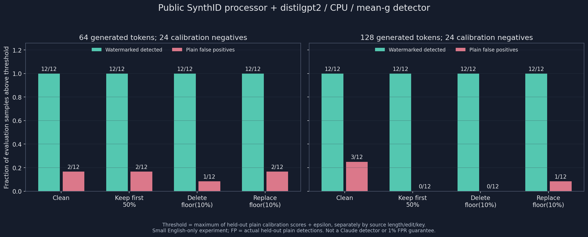

# SynthID Text Lab：玩具機制與公開小模型，分開驗證

這不是 Claude detector。這裡沒有 Claude 的正式 watermark keys，也沒有重現 Anthropic 的私有部署；不呼叫任何付費 API，不要求、不讀取或傳送 API keys。實驗只對公開的英文 distilgpt2，在 CPU 上使用 Hugging Face Transformers 的正式 SynthID Text processor。

## 快速重跑

```bash
git clone https://github.com/chengwulongxia-rgb/deep-dive-code.git
cd deep-dive-code/synthid-text-lab
uv sync --locked --python 3.11

# 預設只有 stdlib 玩具，不載入 torch、不下載模型
python3 main.py
# 固定 seed=42；results/toy.json 保存全部 token IDs 與單步 tournament trace

# 正式 SynthID processor + 真實 CPU 模型 generate；首次下載公開模型
uv run python main.py --real --threads 4 --output results

# 只讀既有 JSON 畫圖，不載入 transformers、不下載模型
HF_HUB_OFFLINE=1 TRANSFORMERS_OFFLINE=1 uv run python main.py \
  --chart results/summary.png --input results/real.json
uv run python main.py --chart results/toy.png --input results/toy.json

# stdlib unittest；官方 processor 測試需已 uv sync，但不下載模型
uv run python -m unittest -v
```

Python 固定 3.11.x，`transformers==4.57.1`、`torch==2.8.0+cpu`；`uv.lock` 固定完整依賴。PyTorch 只從 explicit CPU wheel index 安裝，沒有 CUDA wheel。`--threads` 只接受 1–4，interop 固定 1；CPU float32、eager attention、deterministic algorithms。相同環境與參數可重跑；不保證跨硬體、PyTorch 版本 bitwise 相同。

真實實驗預設每個長度 24 calibration plain、12 evaluation plain、12 evaluation watermarked，共 96 次 generation。小跑可加 `--calibration-count 4 --evaluation-count 2 --output results/smoke`；不得把這個縮小實驗當預設完整實驗的結果。最大 count 是各自預定義的 24/12 個不同 prompt。`--lengths 64 128` 為預設，最小長度 10。

## 第一層：純 Python 教學類比，不是完整 SynthID

`lab.py` 的 toy：256 個 token 的 uniform distribution，每一步抽 16 個候選 token，四輪配對；每輪依 `(key, layer, previous 3 tokens, candidate token)` 的 SHA-256 bit，優先留下 g=1，平手隨機，最後留下 1 個 token。這是 **tournament sampling 的可視化教學類比**，不是正式 SynthID 的完整演算法、reference hashing、sampling table、hash security 或品質證明。玩具的 SHA-256 不能替正式 reference hashing 背書。

正式 HF processor 在完整 logits 分布上做重加權，不是逐步真的產出這 16 個候選。不要把兩者程式執行路徑混為一談。

固定 key 會偏向特定 token，這正是 watermark 設計要留下的訊號。不能把「對隨機 keys 取期望」下的分布性質，誤讀為每個固定 key 都完全不改 token probability。我們沒有做語言品質盲測。

固定 seed 的完整單步 trace 可直接印出：

```bash
python3 -c 'import json; from main import toy_trace; print(json.dumps(toy_trace(42), indent=2))'
```

seed=42、key=123 第一個步驟原始每-token probability=1/256，候選為：

```
57 12 140 125 114 71 52 44 216 16 15 47 111 119 13 101
round 0 winners: 12 140 114 44 16 15 111 13
round 1 winners: 12 44 15 13
round 2 winners: 44 13
round 3 winners: 13
```

各 pair 的 g-bits、平手選擇與 winners 均保存在 `results/toy.json.trace.rounds`。預設 256-token toy 中，正確 key 的 plain mean-g=0.504941、watermarked=0.754941；錯 key 對同份 watermarked 的 mean-g=0.500000。教學判斷規則預設 threshold=0.65、至少 32 個有效 contexts，**不是經驗校準的正式誤報控制**。

固定低熵對照只有 token 7，plain 與 watermarked 完全相同。253 個可成 ngram 的位置，扣掉重複 context 後只剩 1 個有效位置，`detected=null`（證據不足），不能因輸出很長就聲稱水印很強。

## 第二層：正式 HF processor 與透明的 mean-g 檢測

核對的 API 是 Transformers **v4.57.1** 實際安裝來源：

- `SynthIDTextWatermarkingConfig(ngram_len=5, keys=[...], ...)`
- `model.generate(..., watermarking_config=config)`：正式產生水印。
- `SynthIDTextWatermarkLogitsProcessor.compute_g_values()`：檢測同一組 keys 的 g-values。
- `compute_context_repetition_mask()` 與 `compute_eos_token_mask()`：與官方 detector 相同的有效位置規則。

這裡用 **有效位置 × 所有 depth 的 unweighted mean g**，是可檢查的簡單檢測 statistic，不是 watermark probability，也不是訓練過的 Bayesian detector。正式 `SynthIDTextWatermarkDetector` 需要已訓練 Bayesian model；本實驗沒有拿隨機初始 detector 的輸出冒充機率。

模型固定為 `distilbert/distilgpt2`，revision：

```
2290a62682d06624634c1f46a6ad5be0f47f38aa
```

`trust_remote_code=False`、`token=False`、`use_safetensors=True`。CPU generation 固定 temperature=1、top_k=40、top_p=1、do_sample=True、use_cache=True。`min_new_tokens=max_new_tokens` 確保每份為 64 或 128 個**新生成** tokens，排除 prompt；此設定也阻止這段生成提前產生 EOS。EOS mask 仍實作並有測試，不因本次資料沒有 EOS 而刪掉。

水印 ngram_len=5、8 層 keys、sampling_table_seed=0、table_size=65536、history=1024。`skip_first_ngram_calls=True`，生成前 4 個 tokens 不水印；離線打分也排除前 4 個不能形成完整 5-gram 的 tokens。不把 prompt 長度算進水印證據。重複 context 不重複計分。長度小於 5 或沒有有效位置，score=null，不以 0 或 NaN 假裝有效分數。

## 校準與 negative，不能混在一起

- calibration 只有未水印模型生成文字；evaluation 另外 12 個 topics/prompts，seeds 也與 calibration 分離。
- 不同長度有不同 seeds。evaluation 的 plain/watermarked 採相同 prompt 和 seed 配對；這是控制變項，不代表彼此是獨立文件。
- 每個 **原始長度 × 擾動 condition × 檢測 key**，都只用該組 24 份 calibration plain 的 scores 設 threshold：`max(calibration scores) + 1e-12`。
- evaluation 的 plain 與 watermarked 都不參與 threshold 擬合；錯誤 key 也有自己的 plain calibration/evaluation negative，不是拿錯 key 當唯一 negative。
- 僅在 `score > threshold` 時檢出。這保證的是本批 calibration 超標數 0/24（依定義），**不能宣稱真實誤報率 ≤1%**。請看 evaluation plain 的實際 count，樣本少到單個誤報就值得明確列出。
- 閾值按名目 source length 與擾動各自校準；有效 token 數會因重複 context 而不同，逐筆保存。128 截為 64 的組別和原始 64-token 組別不混用校準資料。

## 擾動是 token-ID 層，不是語義改寫或任意網頁的文字偵測

共用已生成序列，不再生成：保留前 50%；刪除 `floor(length/10)` 個位置；把 `floor(length/10)` 個位置換成 vocabulary 中其他非 EOS token。64 刪/換 6 個、128 刪/換 12 個，也就是 9.375%，不是聲稱精確 10.000%。固定每筆 perturbation seed、保存原始被編輯的位置。替換可能破壞字詞及 UTF-8 byte-token 組合，沒有保證自然、流暢或語義相同。

每次編輯後重新算完整 g-values 與所有有效位置 mask，**不沿用原 score 或有效位置**。新增的 ngram 邊界本來就可能失去訊號。

主評估直接使用原始／編輯後的 token IDs。`decode(clean_up_tokenization_spaces=False) → encode(add_special_tokens=False)` **不保證回到同一份 IDs**。逐筆另存 `roundtrip_equal`、`retokenized_token_ids`、`retokenized_score`、`retokenized_effective_tokens`；後者只是診斷，沒有用原 ID threshold 冒充正式文字端偵測。這不是從任意網站複製文字即可使用的 end-to-end detector。

## 產物與結果

- `results/toy.json`、`toy-run.log`、`toy.png`：純 Python 教學機制與 trace。
- `results/generations.jsonl`：每次真實模型 generate 的原始 prompt、prompt IDs、生成 IDs、decoded text、seed、耗時；長跑逐份 flush。
- `results/real.json`：完整逐筆 rows、g-values、valid mask、effective token count、key/condition/split、threshold、environment/versions/revision、timing、roundtrip diagnostics、精確 counts 與 summary。
- `results/run.log`：實際長跑 stdout/stderr。
- `results/summary.png`：深色圖，以並排柱呈現各長度各擾動的真陽性及 evaluation false positives，並標明 count。

下方數值由本次完整實跑填入，不把任何失敗或未執行條件寫成結果。

### 2026-10-22 實跑：沒有縮小樣本

AMD Ryzen 5 5600GT，Python 3.11.15、torch 2.8.0+cpu、4 threads／1 interop；未使用 GPU。**每個長度 24 calibration plain + 12 evaluation plain + 12 evaluation watermarked**，兩個長度共 **96 份原始生成、768 條打分 rows、16 組閾值**。768 並不是 768 份獨立文件，而是 96 × 4 conditions × 2 keys。

模型載入 **16.27 秒**；96 次 generate 耗時合計 **225.42 秒**；載入＋generation＋打分／roundtrip 診斷約 **248.53 秒**（總計時間在繪圖前記錄，未含 uv 安裝與後續 audit）。

WM 指「本實驗正確 key 所生成的 watermarked text」，不是 Claude。以下皆 evaluation counts，threshold 欄是 correct key；wrong key 的獨立閾值保存在 JSON。

| New tokens | Condition | Threshold | Correct-key WM | Correct-key plain FP | Wrong-key WM | Wrong-key plain FP |
|---:|---|---:|---:|---:|---:|---:|
| 64 | clean | 0.531250 | 12/12 | 2/12 | 0/12 | 1/12 |
| 64 | truncate_half | 0.540179 | 12/12 | 2/12 | 0/12 | 3/12 |
| 64 | delete_10pct | 0.532407 | 12/12 | 1/12 | 0/12 | 0/12 |
| 64 | replace_10pct | 0.533333 | 12/12 | 2/12 | 0/12 | 0/12 |
| 128 | clean | 0.525202 | 12/12 | 3/12 | 1/12 | 0/12 |
| 128 | truncate_half | 0.541667 | 12/12 | 0/12 | 0/12 | 0/12 |
| 128 | delete_10pct | 0.544393 | 12/12 | 0/12 | 0/12 | 0/12 |
| 128 | replace_10pct | 0.543347 | 12/12 | 1/12 | 0/12 | 0/12 |

**正確 key 在這些簡單擾動下全部檢出，不代表可部署。** 例如 clean 128-token evaluation plain 仍誤報 **3/12**，雖然對應 calibration 是 0/24。這正是不能把 calibration maximum 或小樣本的漂亮檢出率寫成「1% FPR 保證」的原因。不同條件的樣本共用原始文字，也不能加總成更大的獨立樣本量。



roundtrip 不相等的份數（plain 包含 calibration+evaluation：72 份；watermarked 只有 evaluation：24 份；兩個 source lengths 合計，每份只算一次、不重複算兩把 key）：

| Condition | Plain mismatch | Watermarked mismatch |
|---|---:|---:|
| clean | 16/72 | 7/24 |
| truncate_half | 12/72 | 3/24 |
| delete_10pct | 28/72 | 10/24 |
| replace_10pct | 34/72 | 13/24 |

**連未擾動的原始生成也不一定 decode→encode 等同原 IDs**。所以主表只能支持 token-ID 層的實驗結論，不可以省略這個限制而宣稱任意文字輸入偵測能力。

### 驗證

```bash
# 不載入或下載模型，重算每筆 g-values/mask/score、16 組閾值與所有 counts
uv run python audit.py
# 只使用本機已下載 cache；另核對所有 roundtrip，挑 plain/watermarked 各一份重生兩次
HF_HUB_OFFLINE=1 TRANSFORMERS_OFFLINE=1 uv run python audit.py --replay
```

`results/audit.json`：96 份來源核對通過，768 條 g-values／mask／score 重新計算一致，16 組閾值一致、prompt/seed 不洩漏；768 次實際 tokenizer roundtrip 核對一致。`64-evaluation-plain-00` 和 `64-evaluation-watermarked-00` 各重生 2 次，共 4 次額外驗證 generate，逐 token 與保存原樣本完全相同。這四次 replay 不計入主實驗的 96 份、不更新閾值或 evaluation。

`results/tests.log`：**9 tests passed**，包含 determinism、錯 key、固定低熵、ngram/EOS/repetition masks、空樣本、校準拒絕 evaluation／非 plain 汙染、split seeds/prompts、確定性編輯、預設 toy 與 offline chart CLI、保存結果的全量 audit，以及圖表同時繪出 8 組檢出柱與 8 組誤報柱。無模型的 chart 測試以獨立暫存 output 並設 offline flags；不影響保存的主實驗結果。

`results/api-verification.json` 保存實際 HF API signatures、安裝來源 SHA-256 與 CPU 型號；完整依賴版本由 `uv.lock` 固定。

## 已知限制

小型公開英文模型、少量手寫 English prompts、公開實驗 keys，不能外推 Claude、中文品質、任意人類文字、新聞文章、強力語義改寫、對抗性攻擊或 production false-positive rate。錯 key 分數不是「文字由人類寫的」證明。未檢出不等於非 AI，檢出也不是作者身份或抄襲判決。沒有做品質盲測；這裡只測生成與統計訊號。

DeepMind 明確指出 reference implementation 的 hashing **不提供 cryptographic security guarantees**；不要把可重現的 toy/HF 實驗說成不能移除的加密簽章。

## 官方參考

- HF v4.57.1 API：https://huggingface.co/docs/transformers/v4.57.1/en/internal/generation_utils#transformers.SynthIDTextWatermarkLogitsProcessor
- HF v4.57.1 logits processor source：https://github.com/huggingface/transformers/blob/v4.57.1/src/transformers/generation/logits_process.py
- HF v4.57.1 detector source：https://github.com/huggingface/transformers/blob/v4.57.1/src/transformers/generation/watermarking.py
- DeepMind official repository（含 varying-length calibration 與 hash security 限制）：https://github.com/google-deepmind/synthid-text
- 論文：https://www.nature.com/articles/s41586-024-08025-4

這個子專案只產生程式與實驗資料；不含模型權重、不納入 `.venv`、不自動 commit/push、不發文。
