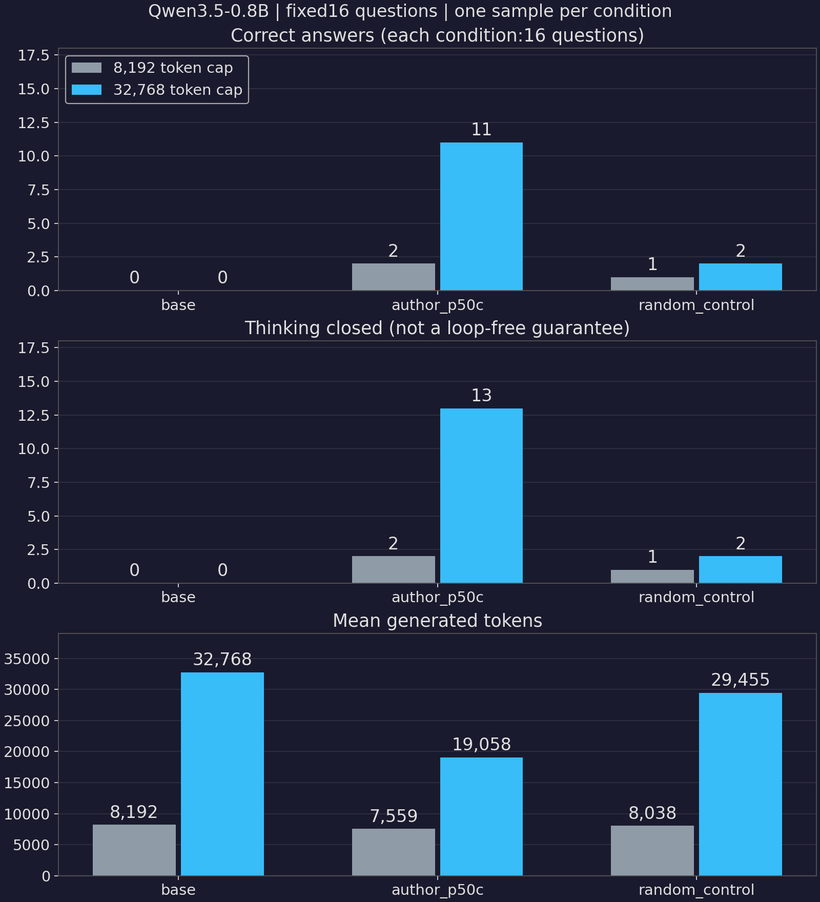

# Qwen3.5 權重編輯：限定範圍重播

主要入口：[weight_edit_colab.ipynb](weight_edit_colab.ipynb)。資料、BF16編輯、模型建立、生成、評分與圖表都在原生cells；不呼叫外部實驗腳本。**預設CPU重播96筆真實輸出，不下載模型、不使用GPU，也不需HF token。**

## 已完成的實測

2026-11-04，Colab L4／BF16，固定16題×三組權重×兩個token上限，每題每條件一次。由中斷輪80筆與補跑輪16筆合併，**不是單一VM的96筆Run all，也不是Astra自主尋找差分的重現**。

- 8,192上限：原版0/16、作者版2/16、隨機對照1/16；結束思考依序0/16、2/16、1/16。
- 32,768上限：原版0/16、作者版11/16、隨機對照2/16；結束思考依序0/16、13/16、2/16；撞到長度上限依序16/16、3/16、14/16。
- 96筆原始prompt、配對seed、完整條件與輸入／控制權重雜湊均核對，CPU重新評分零錯誤診斷。
- 預設CPU入口以乾淨Jupyter kernel跑完10個原生code cells，零cell error，summary與獨立核驗逐欄相同。這不是新GPU生成。
- 補跑16筆的原生Notebook全cells完成、零error；原80筆所在輪因時限中斷，保留timeout，不改成成功。
- 五輪、安裝及失敗累計185.51分鐘，在分次授權200分鐘內；每輪VM均停止並讀回確認。歷史授權不適用新執行，也不是免費／固定價格承諾。



## 入口與證據

- [主要Notebook](weight_edit_colab.ipynb)：預設CPU重評及繪圖；`RUN_GPU=True`才執行完整新96筆，其資料、權重與生成cells與GPU凍結版一致。
- [CPU實際輸出](weight_edit_replay_output.ipynb)：乾淨kernel的CPU Run all，**不是GPU Run all證明**。
- [補跑Notebook](weight_edit_completion.ipynb)：僅最後隨機對照32,768上限的16筆，保留當次設定，不代表完整實驗。
- [evidence/](evidence/)：凍結GPU authored／executed Notebook、版本、差分、各輪耗時與停止紀錄。CLI raw history含認證操作，私下保留；公開executed版排除bootstrap，核原生code後補回原Markdown。
- [results/l4-20261104/](results/l4-20261104/)：完整96筆原始回答、token IDs、prompt及條件（gzip），另保留80筆、16筆各自的原始位元組壓縮檔。合併只加`source_run`，不改模型內容；附精簡逐筆分數、summary、audit與SHA-256 manifest。

## CPU重播與驗收

```bash
cd weight-space-programming-lab
uv sync --frozen --extra notebook --python 3.13
uv run python -B -m unittest test_notebook -v
uv run python verify_replay.py
```

11個離線測試驗證真實grader正反例、BF16、控制組、原始資料完整性及GPU生成cells不變性。`verify_replay.py`只開乾淨Jupyter kernel、執行Notebook與比對summary；**核心不藏在helper裡**。產物在忽略的`replay-output/`。

也可在Jupyter／Colab開主要Notebook，維持`RUN_GPU=False`後Run all，不必選GPU。首次CPU重播可能下載小型固定版MATH-500與本地缺少時的1.1MB壓縮結果，兩者都核SHA-256；套件安裝仍需網路，不是完全離線保證。

## 固定設計與版本

- 模型Qwen/Qwen3.5-0.8B revision `2fc06364715b967f1860aea9cf38778875588b17`。
- 作者日誌revision `4d09ba6d6a7e891dd8063974dfe81b3d78e3494f`，使用`exp8_math/runs/p50c/edit`最終稀疏差分，不呼叫Astra。
- MATH-500 revision `6e4ed1a2a79af7d8630a6b768ec859cb5af4d3be`，500題先以`random.Random(20261104).shuffle`打亂取前16，選題與hash先於推論，不看答案或成績。
- 三組均thinking，temperature0.6、top_p0.95、top_k20、presence_penalty1.5；題目seed跨條件配對，每題僅一次。
- 單一隨機控制seed20261104，在兩個矩陣各64個相同欄位內，逐欄置換作者BF16差值的列方向。保留捨入前範數，另報量化後實際範數、誤差、支援欄位與hash，不宣稱BF16後完全相等。

GPU實測Python3.13.16、vLLM0.25.0、Transformers5.17.0、Torch2.11.0+cu129、math-verify0.9.0、NumPy2.4.6、Matplotlib3.10.0；遠端使用隔離venv，不把CPU lock冒充GPU環境鎖檔。

## 新GPU推論的資源邊界

必須另有已授權的L4、累計預算，以及主機下載、停止與讀回的保留時間。`WSP_DEADLINE_EPOCH`是扣除清理保留後的工作絕對截止；Notebook在階段／批次間檢查，**長生成的硬截止與付費VM停止由主機負責；Notebook本身不申請也不自動停止VM**。本次60+90+50分鐘歷史同意不是新執行授權。

HF token由既有runner安全供給kernel環境；手動Colab使用者也須先自行安全注入，不把值貼進source、`--env` argv或輸出，安裝子程序不繼承它。模型按索引下載實際固定版shard，保留`model.language_model.*`與完整config，設`language_model_only=True`，不載視覺權重、不用`trust_remote_code`；兩個原始及修改後張量都核作者manifest SHA-256。

## 評分與限制

最後完整平衡的`\boxed{}`交math-verify，沒box即錯；解析／比較各一秒，錯誤不刪分母。思考段的box也可能算對，所以另列`thinking_closed`，不能當正常完成的同義詞。

`finish_reason=length`只證明截斷，不等於迴圈，4-gram重複也不是人工真值。第一個救回題花30,200 tokens，思考關閉後仍反覆檢查：收益不等於全部反覆消失。

事後逐token核對：原版與作者版各16/16個長短上限配對具有相同共享前綴，隨機對照僅1/16；其長上限來自另一VM，差異原因未定位。因此隨機1/16→2/16不能視為同一路徑單純延長，固定seed不保證跨runtime位元級相同。

16題、一個控制seed，不是完整500題／每題四樣本，也不是原48.1%數值重現。未做多seed、跨模型或非迴圈型錯誤的充分對照；不能從11/16推論普遍新增數學能力，更沒有測Astra只看原始權重能否理解大型模型。

## 原始來源

- [Weight-Space Programming](https://rikiyat.github.io/blog/weight-space-programming/)
- [Honnibal的方法論批評](https://honnibal.dev/blog/astra-read-write-misleading)
- [固定版官方方法](https://github.com/RikiyaT/lm_understand-logs/blob/4d09ba6d6a7e891dd8063974dfe81b3d78e3494f/exp8_math/README.md)
- [固定版模型卡](https://huggingface.co/Qwen/Qwen3.5-0.8B/blob/2fc06364715b967f1860aea9cf38778875588b17/README.md)
- [固定版MATH-500](https://huggingface.co/datasets/HuggingFaceH4/MATH-500/tree/6e4ed1a2a79af7d8630a6b768ec859cb5af4d3be)
